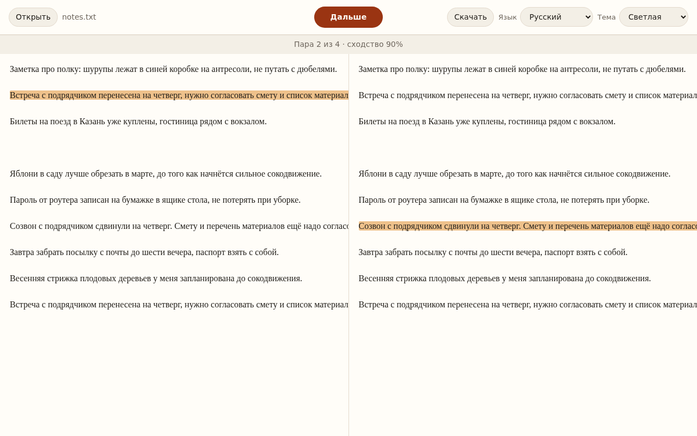

<div align="center">

# Kaimon

[](https://www.gnu.org/licenses/gpl-3.0)
[](https://github.com/yrmuq/kaimon/actions/workflows/checks.yml)

</div>

---

> [!NOTE]
> Kaimon is in active development. Behavior can change, bugs may occur, and a saved language or theme in the browser may no longer match a newer version.

---

Kaimon opens one text file and shows two views of it, scrolled to places that repeat or say the same thing in different words, so those notes can be cleaned by hand. The page is a small web application. The file stays one document: nothing is stored as cut-up records.



---

## Features

- Open one `.txt` file and edit it in two panels
- Find repeated passages and Russian paraphrases locally, without an external API
- Move through the pairs with Next; the mark is only a guide
- Delete the extra text yourself with Backspace
- Download the edited file
- English and Russian interface
- Light, dark, and system theme

---

<details>
<summary><h2>Controls & Shortcuts</h2></summary>

| Input | Action |
| --- | --- |
| Open | Load a `.txt` file into both panels |
| Download | Save the edited text |
| Next | Scroll each panel to the next similar place |
| Backspace | Delete the selection in the panel being edited |
| Language | Switch between English and Russian |
| Theme | Light, dark, or match the system |

Both panels are the same file. A deletion in one panel changes the other. The mark can be shorter or longer than the text you want to remove.

</details>

---

## Installation & Usage

### Architecture & Format Support

No desktop package is published.

| Format | x86_64 | arm64 |
| --- | --- | --- |
| `AppImage` | ❌ | ❌ |
| `Flatpak` | ❌ | ❌ |

No container image is published yet. Build it locally. `arm64` has not been started.

| Architecture | Status |
| --- | --- |
| `x86_64` | Not published |
| `arm64` | Not published |

### Release Scheme

Stable releases are `X.Y.0`. A version `X.Y.Z` with `Z > 0` is an automatic dependency-update prerelease. No stable release has been published yet. The full list is on the [releases page](https://github.com/yrmuq/kaimon/releases).

### AppImage

Kaimon is not distributed as an AppImage.

### Flatpak

Flatpak is not available.

### Docker / Self-Hosted

The compose file is `docker-compose.yml`. The external network `homelab` must already exist. No image has been published, so the first start builds one and downloads the similarity model into that image.

```bash
docker compose up -d --build
```

Once an image is published, update with `docker compose pull` and then `docker compose up -d`.

`.env`:

```
TZ=Europe/Amsterdam
KAIMON=8080
```

The container does not store the text, so there is no data volume. The model is inside the image. Open the page, then download the edited file from it.

---

## License & Attribution

Kaimon is released under the [GNU General Public License v3.0](https://www.gnu.org/licenses/gpl-3.0). See `LICENSE`.

| Component | Upstream | License | Integration Details |
| --- | --- | --- | --- |
| paraphrase-multilingual-mpnet-base-v2 | [sentence-transformers/paraphrase-multilingual-mpnet-base-v2](https://huggingface.co/sentence-transformers/paraphrase-multilingual-mpnet-base-v2) | Apache-2.0 | Local similarity model, baked into the image |
| FastEmbed | [qdrant/fastembed](https://github.com/qdrant/fastembed) | Apache-2.0 | Runs that model on CPU |
| RapidFuzz | [rapidfuzz/RapidFuzz](https://github.com/rapidfuzz/RapidFuzz) | MIT | Scores near-duplicate wording |
